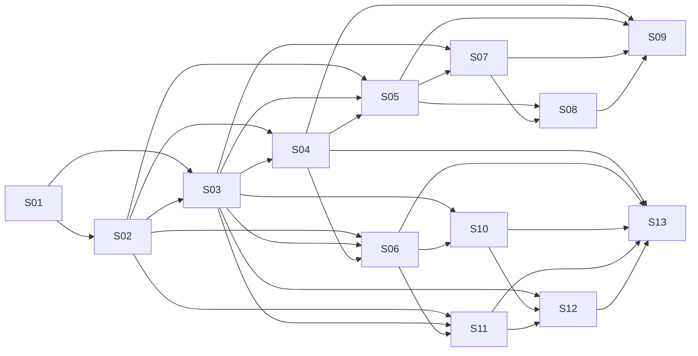

# B. Exact baskets, 13 native spec work packages and DAG

**Four baskets, 13 specs.** Each spec directory has its own native `requirements.md`, `design.md`, and `tasks.md`. Dependency IDs refer only to *completed earlier spec exit gates*. Strict recommended execution order: **01 → 02 → 03 → 04 → 05 → 06 → 07 → 08 → 09 → 10 → 11 → 12 → 13**. Legitimate parallelism: 05/06 after 04; 07 and 10 after their dependencies; 11 after 06; 12 after 10+11. Prefer sequential when a solo builder or cross-contract changes are happening.

| Spec | Basket | Native specification | Dependencies | Main owner | Outcome |
|---|---|---|---|---|---|
| 01 | B1 | [Repository, hosts, persistence and CI](../../.kiro/specs/spec-01-foundation-bootstrap/requirements.md) | — | `src/Hosts.*` | A runnable, observable, structurally enforced .NET 10/React monorepo with real Postgres and Re… |
| 02 | B1 | [Marrow Journal, Simulation and Timeline](../../.kiro/specs/spec-02-timeline-journal-simulation/requirements.md) | 01 | `src/Marrow.Timeline` | One real generic versioned append/restore/replay/fork/continue/comparison engine with complete… |
| 03 | B1 | [Identity, Realtime and reliable integration](../../.kiro/specs/spec-03-identity-realtime-outbox/requirements.md) | 01, 02 | `src/Marrow.Infrastructure` auth/transport/outbox components | Reusable identity/session, typed SignalR transport, bounded message/sorted-set cache primitive… |
| 04 | B1 | [Typed web integration and common Timeline scrubber](../../.kiro/specs/spec-04-shared-web-timeline/requirements.md) | 02, 03 | `web/packages/contracts` | One accessible functional React Timeline control with two domain adapters on real typed HTTP/S… |
| 05 | B2 | [Revenant V1: seeded six-bank causal vertical slice](../../.kiro/specs/spec-05-revenant-v1-slice/requirements.md) | 02, 03, 04 | `src/Revenant` | First real Friday Ring upstream-input stream, pure deterministic payment/hold/settlement proje… |
| 06 | B2 | [Ghost Lap V1: deterministic greybox and first solo ghost](../../.kiro/specs/spec-06-ghostlap-v1-slice/requirements.md) | 02, 03, 04 | `src/GhostLap` | A server-owned deterministic 90-second arena with real movement/candles/charge/contact/Burst/s… |
| 07 | B3 | [Revenant V2: ledger, payments, settlement and cases](../../.kiro/specs/spec-07-revenant-ledger-operations/requirements.md) | 03, 05 | `src/Revenant` payment/ledger/case infrastructure and SQL migrations | Promote spec-05 pure financial rules into genuine durable transactional payment lifecycle, bal… |
| 08 | B3 | [Revenant V2: ML.NET risk, anomaly, liquidity forecast and explanations](../../.kiro/specs/spec-08-revenant-intelligence-liquidity/requirements.md) | 05, 07 | `src/Revenant/Intelligence` | Four honest versioned ML.NET capabilities with reproducible held-out evidence and causally fed… |
| 09 | B3 | [Revenant V2: isolated counterfactual, five functional screens and audit](../../.kiro/specs/spec-09-revenant-counterfactual-ui/requirements.md) | 04, 05, 07, 08 | `src/Revenant` replay application/Worker isolation | Complete five-screen Revenant with actual held workflows, live six-bank flow, v7/v8 isolated c… |
| 10 | B4 | [Ghost Lap V2: authoritative 2–4-player multiplayer and rooms](../../.kiro/specs/spec-10-ghostlap-authoritative-multiplayer/requirements.md) | 03, 06 | `src/GhostLap` room/session loop | One authority per room, true 2–4 remote players, fair room/lobby lifecycle, real interactive m… |
| 11 | B4 | [Ghost Lap V2: persistent solo histories, exact ghosts and branching](../../.kiro/specs/spec-11-ghostlap-solo-history-branches/requirements.md) | 02, 03, 06 | `src/GhostLap` solo application/catalog; consumes Spec-06 codec | Durable owner-verified originals and repeated challenge/fork attempts at any valid tick, exact… |
| 12 | B4 | [Ghost Lap V2: chat, spectator, sharing and rankings](../../.kiro/specs/spec-12-ghostlap-social-ranking/requirements.md) | 03, 10, 11 | `src/GhostLap` messaging/standing/share application | Complete bounded real lobby chat/emotes, spectators/read-only share, rematch/profile/eligible … |
| 13 | B4 | [Ghost Lap V2: complete PixiJS browser game, mobile and journeys](../../.kiro/specs/spec-13-ghostlap-complete-browser/requirements.md) | 04, 06, 10, 11, 12 | `web/apps/ghost-lap` React routes/PixiJS scene/input/audio/UI and `tests/E2E` Playwright browser journeys | Complete connected functional Ghost Lap desktop/mobile product with all requested user routes … |

## Spec DAG (exact direct edges)

This graph is generated from the same dependency metadata used by the native spec requirements/design/tasks files.

## Basket ownership and gates

**B1 01–04 (Marrow foundation).** Compiled modular hosts, real DB/Redis/CI, deterministic Timeline/journal fake-reducer proof, identity/outbox/hubs and one browser scrubber. Gate: clean Compose, actual test-only independent tick/event reducers, auth/outbox retries, both browser shell scrubber imports.

**B2 05–06 (two real application V1s).** Each spec exits independently (06 does not require 05); the joint integration proof runs **once after both** at the basket gate. Six-bank synthetic pure finance v7/v8 *causal* branch; GhostLap deterministic C# greybox and saved original/branch. Gate: same backend engine, same React package, source hash/prefix equality, meaningful visible divergent outcomes. **Early demo-critical milestone.** V1 finance does not yet claim actual DB ledger posting, which B3 adds.

**B3 07–09 (Revenant V2).** Actual database-balanced ledger, holds/four-eyes/settlement, ML.NET four pathways, isolated Worker branch and 5 functional screens/audit. Gate: causal ledger/liquidity policy replay and app E2E with correct transaction/ML provenance.

**B4 10–13 (GhostLap V2).** Server-authoritative remote 2–4P rooms/results, durable solo originals/forks, chat/emotes/spectators/rating/share, connected PixiJS mobile browser game and all screens. Gate: actual remote multi-client and full guest solo/replay/fork browser journeys. Final custom art and a submission schedule are *not* part of Phase 1.

## Checkpoints

C1 after 02: one engine with two test-only reducer shapes. C2 after 06: shared engine with two real app adapters. C3 after 09: source financial ledger unchanged after branch and v7/v8 differences reconciled to ledger. C4 after 13: both app journeys tested in real browsers with actual state/provenance, not demo mocks.

## No two writers

- Timeline manifest/source/branch = Marrow Timeline store; domain writes via ports only.
- Ledger/cases and financial counterfactual result tables = Revenant only, isolated writes.
- Current match/game state and single room scheduler = GhostLap in Realtime host; only compact results durable.
- Ratings/history/share = GhostLap services, consumed from MatchFinalized outbox.
- Identity sessions = Marrow identity; app permissions = respective app.
- Scrubber = shared web package; app-specific scenes/charts remain in each app.

## Spec 03 deferral register

Concerns left open at the Spec 03 exit gate (2026-11-10). Each owner must show the listed proof before its own exit gate. Spec 03 semantics they build on: `07-realtime-room-authority.md`.

| Concern | Owner | Required proof in the owning spec |
|---|---|---|
| TypeScript `RealtimeStreamClient` tested only with a scripted transport; browser reconnect | 04 (final Ghost Lap journeys: 13) | Real browser client against the real `Hosts.Realtime` hub: subscribe, drop, reconnect, gap refetch, forbidden stream. |
| Real owner/membership lookups behind the default-deny ports | 05, 07 (Revenant); 06, 10, 11 (Ghost Lap) | Domain `IResourceOwnershipLookup`/`IMembershipLookup` from the domain's own tables; cross-owner and cross-identity denial tests at its endpoints and hub streams. |
| `TenantId` is always null (single tenant) | 07 (with 09) | Validated tenant claim plus RLS as Spec 07 specifies; a guessed tenant or history id is denied even with a forged request owner. Shared identity must not invent tenancy before then. |
| Domain outbox/inbox tables and transactions | 07 (financial effects); 10, 12 (match results, social/ranking consumers) | Domain migration with the `MessagingTables` shape; business row + outbox row in the domain's own transaction; consumer effect + inbox row atomic; duplicate delivery gives one effect. |
| Stream trimming, retention, poison/dead-letter requeue tooling, Redis throughput under `appendfsync always`, re-publish after Redis volume loss | 07, 12; verified again at final deployment acceptance | Measured throughput (no unmeasured claims). Trimming never removes entries any group has pending or unread. Requeue goes through outbox/inbox so dedup still holds. Operator procedure for poisoned rows and dead-letter streams. |
| Host registration and domain use of the Timeline engine | 05, 06; Ghost Lap durable histories 11 | `AddMarrowTimeline` in the hosts with a login holding `marrow_timeline_runtime` (extend `scripts/db/migrate.sh` login mapping); domain adapters through `ITimelineEngine` only. |
| Per-room ownership and fencing under real game traffic; revalidation sweep cost at room scale | 10 | Fencing-token/epoch ADR before any Realtime replica > 1; stale owner writes rejected; measured revocation bound with real room connection counts. |
| Worker/Realtime domain DB grants | each domain spec that adds Worker or Realtime work (07, 09, 10, 12) | Grant only the new module runtime role to `sands_worker`/`sands_realtime`; least-privilege test like `The_executor_provisions_least_privilege_host_logins_without_printing_passwords`. |
| Staff password reset/change, per-account login rate limiting beyond Identity lockout (5 failures, 15 min) | not in any Spec 03 requirement; first spec that exposes staff accounts beyond dev seeding (07/09 operator workflows) must decide | If adopted: reset tokens single-use and hashed, sessions revoked on password change, rate limits per account and per source. |

Accepted v1 limitations (no owner change needed): the advisory lock is a deployment guard, not a fenced lease (about 10 s possible overlap after a silent lock-session loss); hub revocation is bounded (default 10 s), not instantaneous; loss of the Redis data volume or of fsynced storage is outside the supported outbox failure model.

## Spec 05 handoff register

Spec 05 (2026-11-10) delivers the pure `FinanceReducer`, `CounterfactualMetrics`, scenario generator, versioned codecs and `FinanceTimelineAdapter`, plus a test-only HTTP bridge (`tests/E2E/backend/RevenantSliceEndpoints.cs`). Ownership below was checked against the requirement files of specs 07, 08 and 09.

| Concern left open by Spec 05 | Owner | Required proof in the owning spec |
|---|---|---|
| Real posting, ledger transactions, balanced-posting trigger, legal lifecycle in PostgreSQL. Slice `Settled` is a projection only. | 07 (R07.01, R07.02, R07.11) | `Settled` commits balanced linked legs atomically. The reducer is consumed unchanged (`HandoffContractTests` freeze its surface). |
| Durable `ScenarioRunId` identity. The slice run registry is in memory and loses bank names and the recorded source hash on a host restart. | 07 (R07.12); 09 (R09.12) | Run-scoped bank/account state and `(ScenarioRunId,intentId)` idempotency persisted in the Revenant schema. Both runs' records retained. |
| Production Revenant API with bank-staff/tenant authorization. The slice authorizes only the guest owner of the history. | 07 (R07.05, R07.08, R07.13), 09 (R09.03, R09.04) | Domain `IResourceOwnershipLookup`/`IMembershipLookup` from Revenant tables. Cross-owner, cross-tenant and unauthorized-staff denial tests at the real endpoints. |
| Production host registration of the Revenant Timeline engine (`AddMarrowTimeline` with `FinanceTimelineVersions.All` in `Hosts.Api`/`Hosts.Worker`). Today only the test host and `tests/Revenant` register it. | 07 (API), 09 (`Worker.Replay`) | Host composition with a login in `marrow_timeline_runtime`. Committed OpenAPI/TS contract updated in the same change. |
| Financial outbox/inbox for payment, hold and settlement events. | 07 (R07.09) | Business row and outbox row in one transaction. Duplicate delivery gives one effect. |
| Review actions on holds. Input schema `revenant-payment-intent/1` has none, so a hold stays pending and `fraudPreventedCount` stays 0 in the slice. | 07 (release/reject), 09 (R09.11 `analyst-continuation-v1`) | Terminal prevention counted only after a recorded reject/return that never settled. |
| Fraud/risk scoring, anomaly and liquidity forecast. The slice uses rule policies `policy-v7`/`policy-v8` with no learned model (`NoModelArtifact`). | 08 (R08.02, R08.04, R08.06) | Version-pinned model artifacts and evidence recorded per decision. Forecasts built from the actual causal series. |
| Metric presentation, replay isolation and interpretation: Worker.Replay role, hash audit, five screens. `counterfactual-cost-v1` is in USD minor units (250 per false positive, 10 per delay minute, 120-minute cap); Spec 09 design states the same units. | 09 (R09.04, R09.05, R09.07, R09.10) | Source ledger rows and hashes unchanged after a branch. Pending fraud shown as deferred and never monetized. |
| Joint B2 basket gate (same engine and scrubber across both apps). | 05 and 06 together | Runs once Spec 06 exits. Revenant half recorded in `docs/kiro-log.md`. |
