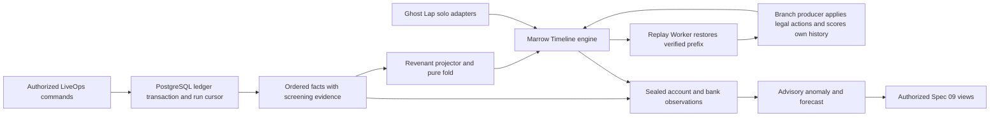

# Spec 08 architecture inspection

**PROVISIONAL — REQUIRES DEEP RESEARCH APPROVAL**

Inspected `main` at `2fde4a57f2f229743bc43d8a41e6bc989d433d09`, equal to the local `origin/main` reference. The initial tree had one unrelated untracked file, `SPEC_07-13_ARCHITECTURE_AUDIT.md`. This report uses tracked source, canonical artifacts, tests, historical results and [CI for this exact commit](https://github.com/nightwing9-bit/the-sands-of-time/actions/runs/43049068887). No tests or training were run in this inspection. Status labels distinguish source confirmation, historical observations and missing proof.

## A. Executive architecture verdict

The original two-app demo is technically feasible. It depends on proving incremental detection under a realistic synthetic review budget and useful 40-minute forecasts with calibrated uncertainty. Both are **BENCHMARK GATES**. The minimum architecture is an additive Revenant finance family, called V4 provisionally, with a deterministic clock, explicit observation seals, and a forkable policy context. Use the existing PostgreSQL ledger and Marrow Timeline. Build a separately versioned enhanced Friday Ring from real ledger actions, with independently generated operating histories and a 09:00 fork. Keep the legacy seed, policies, bytes, model and history registrations intact.

Train behavioral fraud scoring offline and score within LiveOps. Derive velocity anomalies and liquidity forecasts from the same sealed observations. The initial candidates are FastTree, a trained seasonal/peer count residual detector, and a small flow-conditioned multi-horizon forecast. Run the SSA detector and forecaster as measured challengers if the review approves alternate methods. The current Spec 08 explicitly requires both SSA workloads and the deployed Linux AMD64/glibc path. Approval of a change to that method requirement is an explicit prerequisite to shipping alternatives alone. Forecasts and bands remain product requirements either way. Do not build a separate serving platform, a second ledger, a generic ML registry, or a second Timeline implementation.

The principal review decisions are the independent evaluation design, the precise observation and scheduling contract, native runtime scope, and the continuation policy for real analyst actions. Recommend shipping a single integrated new history with source **v7 rules + behavioral model** and child **v8 rules + the same model**, isolating the policy change at the fork while allowing scores to change with the branch history. An explicitly pinned rules-only or different-model child is useful for controlled comparisons under the same new version. A rules-only child must be a deliberate policy, never an availability fallback.

## B. Actual repository evidence

Authority consulted includes [project context](../../MARROW_FINAL_PROJECT_CONTEXT_UPDATED.md) §§2, 4 and 6, [shared contracts](../architecture/03-contracts.md), the [Kiro log](../kiro-log.md), [prior recovery journal](../spec08-ml-recovery-journal.md), Specs [05](../../.kiro/specs/spec-05-revenant-v1-slice/tasks.md), [07](../../.kiro/specs/spec-07-revenant-ledger-operations/tasks.md), [08](../../.kiro/specs/spec-08-revenant-intelligence-liquidity/tasks.md) and [09](../../.kiro/specs/spec-09-revenant-counterfactual-ui/tasks.md), and ADRs [17](../adr/ADR-P1-17-finance-ledger-version.md), [18](../adr/ADR-P1-18-tenant-bearing-staff-and-four-eyes.md), [19](../adr/ADR-P1-19-risk-features-and-inference-evidence.md) and [20](../adr/ADR-P1-20-model-aware-finance-v3.md). Task boxes and earlier scope-reduction recommendations are historical evidence.

| Subsystem | Current implementation | Exact files/types | Evidence | Status | Recovery impact |
|---|---|---|---|---|---|
| Scenario and V1 | Six banks, 90 seed-42 intents, generated topology and stable IDs. Intent-only pure fold, immediate clear settlement, reserve on hold. v7/v8 canonical rules. | `src/Revenant/Scenario/FridayRingScenario.cs`, `src/Revenant/Finance/{PolicyConfig,FinanceReducer,CounterfactualMetrics}.cs`, `src/Revenant/Timeline/{FinanceTimelineAdapter,FinanceTimelineVersions,FinanceTimelineCodecs}.cs` | `tests/Revenant/Timeline/FridayRingTimelineTests.cs` checks fork at position 30, unchanged prefix, suffix policy, replay, source immutability, 10 deferred and zero prevented. v7 threshold 8 with $1,000 floor, v8 threshold 5 plus new-beneficiary amount threshold $1,500. Both hold sanctions hits. | Confirmed in code and assertions | Keep `friday-ring/1` and the V1 comparison. Separate enhancement. |
| Ledger and V2 | Run-scoped accounts and USD minor units, balanced posting groups, available-balance guards, reservations, review, settlement and compensating returns. Ordered intents, screening, review, settlement, returns. Production V2 is v7. | `src/Revenant/Payments/PaymentLedgerStore*.cs`, `src/Revenant/Timeline/{FinanceLedgerVersion,FinanceLedgerReducer,FinanceLedgerCodecs}.cs`, migrations `0001`–`0007` under `scripts/db/migrations/revenant/` | SQL constraints, locks, one-time facts, RLS and audit/outbox transaction. `LedgerConstraintTests`, `SettlementTests`, `CaseWorkflowTests`, `RevenantAccessAndFactTests`. | Confirmed | Preserve accounting paths and transaction/privilege boundaries. |
| Human actions | Staff and run membership, MFA for disposition, optimistic versions, distinct supervisor for second approval (USD >= 1,000,000 minor or other currency). Reject releases active hold. Settled return requires destination funds and reverse posting. Assignment/comment are operational audit data, with no reducer effect. | `src/Revenant/Cases/ReviewRules.cs`, `src/Revenant/Payments/{RevenantRunAccess,RevenantLedgerService,PaymentLedgerStore.Cases,PaymentLedgerStore.Settlement}.cs` | `ReviewRulesTests`, `CaseWorkflowTests`, `SettlementTests`. Existing V2/V3 review payload records slot/count/result/review policy without reviewer identity. | Confirmed | Re-authorize branch actions using explicit provenance. A copied approval slot does not prove actor eligibility. |
| Ordered facts and closure | Gap-free run cursor serializes commits. Unique financial step facts. Projection catches up by Timeline position; closure permits Held and excludes outstanding initiated/approved/cleared work. Closed cursor blocks future facts. | `PaymentLedgerStore.Closure.cs`, `src/Revenant/Projection/{LedgerProjector,LedgerProjectionWorker,ModelLedgerProjector}.cs`, `0002_payment_intake.sql`, `0005_audit_projection_relay.sql`, `0007_run_closure.sql` | `LedgerProjectionTests`, `RunClosureTests`, `ModelAwareScreeningTests`. Reconciles statuses, trails, reservations, holds, cases, postings and balances; V3 adds reason checks. | Confirmed | Verification must include clock and observation parity. Do not reopen verified originals to extend a forecast. |
| V3 scoring | `v7-base+ml-risk-v1` and one exact model. Payment, account and cursor locks bind pre-screen posted balance and prefix to evidence at the next fact. Pure V3 validates binding and uses recorded PPM. | `src/Revenant/Payments/PaymentLedgerStore.Screening.cs`, `src/Revenant/Intelligence/{RiskPolicy,InferenceEvidenceV1}.cs`, `src/Revenant/Timeline/ModelLedgerFinance.cs`, `0008_model_aware_screening.sql` | Migration RV010 checks shape. Pure reducer validates hash, policy, position, feature snapshot and base decision; authorized producer supplies the prediction. `ModelLedgerReducerTests` covers threshold and tampering. | Confirmed | New model/schema cannot be slipped under the V3 pin. Reuse transaction pattern. |
| Artifact and evaluation | Pinned FastTree artifact, four features, single-thread offline trainer, deterministic chronological step split with origin/scenario purge. | `src/Revenant/Intelligence/{RiskFixture,RiskDatasetEtl,RiskFeaturesV1,RiskEvaluation,RiskModelTrainer,RiskModelManifest,RiskModelScorer}.cs`; `Artifacts/risk-fixture-fasttree-v1/` beneath Intelligence | Committed manifest and ZIP digest confirmed by OpenSSL. Fixture generator redraws balances per row. Old test metrics are fixture-only. | Confirmed | Reuse build/evaluate/verify conventions. Replace primary training cohort and feature contract. |
| Production composition | LiveOps Worker registers V2/V3 projection, screening, settlement, relay and inbox. API opens V2 only, has case/return/audit routes. No product Replay process, dedicated risk/forecast route, or public close-and-verify route. The audit verification route is a separate read. | `src/Hosts.Worker/Program.cs`, `src/Hosts.Api/Program.cs`, `src/Revenant/Api/RevenantLedgerApi.cs`, `src/Revenant.Contracts/LedgerApi.cs` | `OpenRun` omits internal `modelAware` parameter. V1 real backend fixture registration lives in `tests/E2E/backend/E2eTimelineEndpoints.cs`. Existing Revenant web shell/fixture share the scrubber. | Confirmed | Add a normal model-aware entry point and versioned read DTOs. Keep fixture endpoints separate. |
| Runtime | Production Revenant references core/FastTree 5.0.1. TimeSeries is probe/test-side. Worker image is Alpine. CI x64 probe uses glibc and OpenMP. | `src/Revenant/Revenant.csproj`, `tests/Revenant/Platform/MlPlatformProbe*.cs`, `scripts/checks/ml-platform-probe.sh`, `.github/workflows/ci.yml`, `deploy/docker/Worker.Dockerfile`, `deploy/compose/docker-compose.yml` | Exact-HEAD CI run 43049068887 succeeded. The [Linux x64 job](https://github.com/nightwing9-bit/the-sands-of-time/actions/runs/43049068887/job/130681257409) reports successful architecture, OpenMP, fit/save/load/predict and evidence upload steps. Historical log reports native macOS ARM64 FastTree and emulated Linux x64 SSA; OpenMP naming mattered. | Confirmed CI result; deployed ML/SSA proof UNVERIFIED | Validate actual published artifact and process image independently of the probe. |
| Shared Timeline | Persistent source, checkpoints, replay and fork suffix use one engine; each segment resolves its own pinned context and child inherits version family. | `src/Marrow.Timeline/{TimelineEngine.cs,Internal/PersistentTimelineEngine.cs}`, `src/GhostLap/Solo/{SoloOriginals,SoloBranches}.cs`, `src/GhostLap/Timeline/GhostLapTimelineVersions.cs` | Ghost Lap invokes the same generic engine against its own transition/codecs. Finance invokes the engine through its adapters. | Confirmed source reuse | No engine or game changes needed for this recovery. |

### Existing ML lifecycle

`risk-features-v1` uses log1p amount in major units, log1p source posted balance before screening, capped amount/posted ratio and drain flag. The last two derive from the same two raw integers. It rejects amounts and posted balances above 2^53, invalid currency, negative posted balance and nonpositive amount. ETL accepts PaySim-shaped TRANSFER rows, converts decimal nominal units to synthetic USD minor units (half away from zero), excludes post-balances and proxy flags, partitions observed distinct steps 60/20/20, purges cross-split source/scenario groups, and invalidates inadequate cohorts. Graph-wide or recipient leakage is outside this split guarantee.

The manifest records 3,240 rows read, 3,040 eligible before group purge, 1,817 train / 609 validation / 514 test. Trainer seed 8201, one thread, 100 trees, eight leaves, minimum ten examples per leaf and learning rate 0.1. The built-in calibrated probability becomes PPM via one round-half-away-from-zero after validating finiteness and [0,1]. Threshold 257,796 PPM selected on validation F1, tie by precision then higher threshold. The held-out manifest reports TP 30 / FP 14 / TN 458 / FN 12, F1 0.698, PR-AUC 0.739, ROC-AUC 0.926, prevalence 42/514. No real-world calibration or independent PaySim result follows from these figures.

`revenant-risk-fasttree-fixture/1` ZIP SHA-256 `c13491fef4252e462165c84d1df5c861596638ca60eeb9e86fd020496aacd3de`; canonical manifest SHA-256 field `00431188ea8ac78cfa948ef2da78383f659b5c1ada5dec78e89171ac646c658a`. Artifact content is copied to output; provider loads from the published artifact root (configurable), validates package, manifest, schema and ZIP, compares loaded identity to the pin and caches successes. Failed loads retry on a later pass. Scorer uses a fresh data view through a loaded transformer without a shared mutable prediction engine. Existing probe/manifest parity covers specific inputs; prove concurrent scoring and near-threshold parity on the actual package/runtime images. Reproducible loaded decisions and predictor-free exact replay are required. Byte-identical cross-platform retraining is not promised.

V3 base rules use candidate-inclusive velocity from the intent prefix before that candidate, rather than the later model screening prefix. Ledger available balance controls whether a requested hold becomes a reservation or an insufficient-funds rejection. V3 currently scores even when a base rule holds, retains that reason, and only uses a learned hold for a base-clear decision at or above threshold. Missing model skips V3; per-payment typed failures roll back and back off. Two gaps in this handling appear in D and I.

## C. Dependency and version map

| Family | Canonical keys and authority | Policy and fork |
|---|---|---|
| V1 | `revenant-finance-reducer/1`, `revenant-payment-intent/1`, `revenant-finance-state/1`, `revenant-finance-context/1`. Scenario intent → pure Timeline fold. | Existing v7→v8, sealed legacy comparison. |
| V2 | `revenant-finance-reducer/2`, `revenant-finance-fact/2`, `revenant-finance-state/2`, `revenant-finance-context/2`. Ordered PostgreSQL steps → pure Timeline fold. | Production pinned v7; context accepts legacy policy pins, but mechanically reusing the suffix can encounter illegal review/settlement/return steps. |
| V3 | `revenant-finance-reducer/3`, `revenant-finance-fact/3`, `revenant-finance-state/3`, `revenant-finance-context/3`. Model evidence replaces screening step payload. | One risk-policy catalog pin; base policy is bound. Valid same-family recomputation is architecturally possible but lacks full process-cold branch proof. |
| Proposed V4 | New reducer, fact, state and context versions under the same domain. Explicit clock/observation data, behavior features, new inference schema, durable per-run policy and scenario pins. | Compatible v7/v8 policy combinations under one shape. Inherit prefix, branch-local suffix, compare at shared simulated time. |

V1/V2/V3 checkpoint/state hashes, canonical context bytes, fact decoding, thresholds and policy pins are **COMPATIBILITY BLOCKERS** for changes in place. New reads over legacy data can be additive with a typed unsupported state for missing observations. A cross-version backfill would be a new derived history with provenance, never a Marrow fork; it adds no value to this demo. Canonical evidence and compatible codecs/catalog entries suffice for predictor-free replay. Retain the ZIP and manifest for exact re-scoring and deployments that still screen legacy runs.

## D. Root-cause and risk register

IDs 1–12 correspond to the previous audit. “Confirmed (historical)” identifies recorded observations, with source confirmation of their mechanism and no fresh execution.

| Issue | Evidence | Severity | Minimal correction | Required verification | Work package |
|---|---|---|---|---|---|
| 1 Confirmed — fixture balance/ratio shortcuts | `RiskFixture.cs` redraws balances, positive distribution differs; manifest states the bias | High | Stateful episodes, matched overlaps | Amount-only and matched-pair controls | 2–3 |
| 2 Confirmed — four features omit behavior | `RiskFeaturesV1.cs` only two raw inputs | High | New causal feature contract | Parity, ablations and rule comparison | 3 |
| 3 Confirmed (historical mechanism) — FR-0041 schedules | Test screens whole cohort before settlement; store samples posted under lock. Prior journal gives 1,000,000 vs 314,052 posted minor for same amount 143,381; sequential score 253,652. Individual live PPM UNVERIFIED. | Medium | Regenerate evidence join; compare identical prefixes before comparing schedules | Verify both feature hashes and PPM on same pinned runtime; account for all 90 | 4 |
| 4 Confirmed — published histogram counts 89 | 60 legitimate + 29 ring in Kiro log; integration asserts 90 generated rows and three controlled rows separately | Medium | Generate report from canonical decision table | Unique intent join, bucket sums and maximum | 4 |
| 5 Confirmed — 2^53 admission gap | `SubmitIntentAsync` lacks family limit; `RiskFeaturesV1` rejects out-of-range; backoff rolls back and retries poison head | High | Family-aware admission, bound evolving inputs, typed backlog handling | Boundary + 1, legacy valid retries, liveness across runs | 4 |
| 6 Confirmed — artifact I/O escapes | `RiskModelScorer.Load` checks existence then reads; manifest catches JSON only; ZIP read outside load error boundary | High | Map missing, denied, transient I/O and corrupt data; scoped backoff | Permission-denied and read-after-probe race, no downgrade, restore and retry | 4 |
| 7 Confirmed — insufficient account observations | `FridayRingScenario` limited burst history; TimeSeries spike probe is synthetic API smoke | High | Sealed regular windows, independent warm-up regimes | Normal burst controls and alert budget | 2, 5 |
| 8 Confirmed — insufficient forecast observations | V2/V3 intake clock and short scenario cannot identify stable bank dynamics or validate 40-minute intervals | High | Multi-day legal prehistory and rolling holdouts | Error, lead time and coverage | 2, 6 |
| 9 Confirmed — intake-only clock | Cursor updates time on intake; review, screening, settlement/returns have sequence but no equivalent business-time advancement | High | V4 clock and observation seals | Idle, tie, late fact, restart, manual action, branch tests | 2 |
| 10 Confirmed — different version pins | Families and context resolvers in C | High | One V4 family for integrated demo; retain earlier versions | Exact legacy bytes and illegal cross-version fork | 2, 7 |
| 11 Confirmed — predictor-free history | `ModelLedgerReducer` reads evidence and checks state; tests remove provider from replay DI | High invariant | Preserve separation | Artifact absent, predictor prohibited, historical bytes exact | 4, 7 |
| 12 Confirmed — full proof still absent | V3 test fresh provider is in the same test process. No branch invocation there. | High | Real V3 same-policy suffix proof and V4 alternate-policy proof | Distinct process, new branch inference, no live writes | 7 |
| V1 prevention claim | `FridayRingTimelineTests.cs` expects 10 deferred, zero prevented, zero avoided principal | High product | Legal terminal intervention and distinct metrics in V4 | Deferred later settles, branch-only reject, reversal and status matrix | 7 |
| Generated cohort and controlled hold | Kiro log reports all 90 Clear; controlled CTL-83-M is legitimate. Test constructs it after settlement. CI success does not repair cohort quality or reconcile the published histogram. | High product | Frozen enhanced golden scenario and independent cohorts | Real learned holds on generated positive transfers plus benign controls | 3, 7 |
| Truth and worker ordering | Legacy `PaymentIntent` and HTTP submit carry caller-supplied truth. `SKIP LOCKED` does not fix equal-seed interleaving. Generic `TransitionAsync` can make an old run non-reconcilable. | High | V4 private truth sidecar, admitted commands and deterministic demo dispatch | DTO/feature exclusion, two Worker instances, verification rejects missing fact | 2, 4 |
| Projection and deployment gaps | Exact-HEAD CI is successful (**Changed** from pre-commit audit uncertainty); source remains V2-only via public open. Worker Dockerfile Alpine, no pinned AMD64 platform. | High | Add normal entry, verify published runtime and deployment | Same-image scoring, DB roles and restart, optional SSA production gate | 4, 7 |

## E. Primary data strategy

Train first on **project-owned stateful episodes**. Use independently authored, frozen simulator families for the primary evaluation. Consider external benchmarks only as separately scoped tasks. A 40-minute forecast and minute-scale fraud features need authoritative intent, review and posting time as well as account linkage. None of the external releases below supplies that ledger contract.

| Rank/source | Provenance, access and license | Observations and target | Appropriate use and limits |
|---|---|---|---|
| 1. Project-owned C# simulation | Deterministic checked-in configs, separately pinned scenario and scheduler versions, offline and network-free | Exact time/order, banks/accounts, posted/reserved balances, true action lifecycle, blinded transfer intent labels and future outcome labels | Primary train/validation/calibration/test with independent scenario design. Shared simulator assumptions limit external validity. |
| 2. IBM AML-Data / released transactions | IBM synthetic virtual-world agents. IBM declares CDLA-Sharing-1.0 for its original data and Apache-2.0 for repo code. Verify the exact newer Kaggle release terms and redistribution obligations separately. | Bank/account links, timestamp, received/paid amounts/currency, payment format and laundering label. Timestamp precision and ordering in the chosen file require inspection; no authoritative hold/approval/pre-post state. | Independent simulator benchmark for graph/time behaviors at supported granularity, under separate AML label. Exclude format/currency shortcuts or report stratified. Split by connected components or whole generated worlds. [IBM repository](https://github.com/IBM/AML-Data), [authors' paper](https://arxiv.org/abs/2306.16424) |
| 3. PaySim | Author's Java simulator is GPL-3.0. Its linked Kaggle data card/metadata produced no readable terms here. CC BY-SA 4.0 is reported elsewhere but remains **UNVERIFIED** for the exact archive; confirm account/terms, redistribution and derived outputs before use. | Hourly step, transaction type, amount, source/destination IDs, old/new balances, fraud label and rule flag. Author's research describes account takeover, transfer to mule and cash-out. Strictly earlier-hour linkage is possible where IDs recur; within-hour causal order, fine-grained velocity, holds and real settlement are unavailable. Merchant/other balance fields cannot be assumed to reconstruct the ledger. | Secondary transfer-only benchmark using separately trained compatible feature subset; audit repeats, cash-out dependence, and whether hour-level linkage has support. Cash-out as distinct task or link only when observable; never cast it as a Revenant transfer. Drop post-state balances, isFlaggedFraud and type proxy across pooled tasks. [Author's repository](https://github.com/EdgarLopezPhD/PaySim), [author's thesis](https://bth.diva-portal.org/smash/get/diva2%3A955852/FULLTEXT06.pdf), [dataset page](https://www.kaggle.com/datasets/ealaxi/paysim1) |
| 4. AMLSim | IBM Apache-2.0 code with attribution/NOTICE as applicable; verify specific outputs and bundled dependency terms. Documented Java 8 + jars/Maven and Python 3.7 with legacy dependencies including NetworkX 1.11. Seeded config and pattern files; test exact commit and generation determinism before claiming reproducibility. | Transaction IDs, endpoint accounts, amount, type, step/date and SAR/alert membership. Default conversion uses day-level dates. A generated alert is an AML typology label; configured typology and alert IDs would leak targets. No reconstructed review/hold ledger. | Useful independently authored graph-pattern stress set or ideas for blinded families. Another simulator, with no real-world validation. Defer running its legacy toolchain on M4; any optional execution in a pinned disposable offline environment. [IBM AMLSim](https://github.com/IBM/AMLSim), [output schema](https://raw.githubusercontent.com/IBM/AMLSim/master/paramFiles/1K/schema.json), [converter](https://raw.githubusercontent.com/IBM/AMLSim/master/scripts/convert_logs.py) |
| Exclude IEEE-CIS | Kaggle/Vesta competition. Competition data/rules pages were unreadable through this inspection; treat acquisition and reuse terms as unverified. | E-commerce fraud classification, relative transaction time and anonymized attributes. Stable payer→payee bank graph and as-of posted/held state cannot be inferred reliably from identity proxies. | No decision-critical overlap. Avoid reconstructed identities as leakage or as evidence for mule detection. [Data](https://www.kaggle.com/competitions/ieee-fraud-detection/data), [rules](https://www.kaggle.com/competitions/ieee-fraud-detection/rules) |

### Labels and episode contract

The classifier target is **synthetic unauthorized or fraud-facilitating transfer participation** defined by a blinded scenario author before policy evaluation. Include coordinated chain transfers, distributed smaller payments, fan-in/fan-out and rapid onward movement by well-funded accounts. A blocked attempted transfer can still be positive. Do not label a transfer positive simply because it was held, involved a high-velocity account, or resembled an AML pattern. AML participation requires its own ground truth and benchmark. Generic unusual behavior is advisory anomaly. Sanctions and the explicit v7/v8 thresholds remain transparent rules. Legitimate controls include retail, high-value and near-drain transfers, payroll and supplier bursts, novel beneficiaries, repeated beneficiary relationships and fan-out/fan-in lookalikes.

- **Manifest:** immutable episode/source ID, family and generator build, config and seed/stream hashes, time-zone/calendar and scheduler version, scenario/reducer/policy pins, topology and opening totals, observation cadence, published schedule provenance, ordered raw fact hash and separate truth hash. Persist split assignments before feature extraction; a re-generation gets a new manifest if any definition changes.
- **Rows:** stable episode-local account/bank/intent/action IDs for joins; availability time, effective simulation time and run-local order; canonical intent, clock, step and authorization facts; observation seals. Persist the actual action result and canonical fold outputs for parity checks. Truth sidecar gives intent-level class, family/ring membership and assignment policy, available only in evaluation. Derive episode outcome at declared horizons from legal postings and dispositions. Do not label from outcome. Keep demo truth server-side and authorize aggregate readouts.
- **Generators:** create background customer, payroll, merchant and treasury streams before injecting hidden actor instructions. Use independent RNG substreams for topology, benign behavior, fraud and execution schedule. Generate amounts, funding and cadence with overlaps across classes; draw lookalikes under shared distributions and represent attack stages through causal actions. Vary bank sizes, account ages, velocity regimes, case queues, holds, reject/release/settle/return timing, and system schedules. Use balanced internal postings for prehistory. Run the shared pure finance command/fold path offline and a small equivalence cohort through PostgreSQL. Keep declined/ineligible actions with explicit reasons for data auditing.
- **Partitions:** disjoint episode seeds, reusable templates/families and connected-account components across splits, including both endpoints and reusable topology clones. Within episodes use chronological prefixes; purge overlap if splitting temporal segments, including feature lookback and forecast label horizon. Prefer whole episode splits. Separate training, model validation, calibration/threshold validation and untouched final tests. Keep enhanced Friday Ring seed/author/config out of tuning. Fit scalers, bins and imputation on train only; calibrate and choose review budget threshold outside the final split. Record counts, prevalence, missingness, duplicates, invalid money and ordering/reconciliation failures. Fail empty, single-class, insufficient-history or graph-overlap cohorts, with undefined metrics explicit.
- **Planning sizes, not measurements:** tiny deterministic parity fixtures in CI. First budget on the order of 10^4–10^5 eligible intents across tens to low hundreds of independent six-bank episodes, with hundreds of fraud events distributed across rings, plus multi-day histories for liquidity. Size the untouched test by uncertainty at the episode/ring level and minimum positive rings per reported family. If supports are thin, add untouched episodes before unblinding. Millions of rows and repeated nightly training are unnecessary.
- **Circularity gate:** generator author freezes independently motivated holdouts, with hashes and restricted truth access, before model tuning. Evaluation custodian runs untouched episodes, new families and changed legal execution schedules. Train a one-feature/amount-balance-only classifier and identifier/time-only diagnostic; check mutual overlap by binned amount, fraction, frequency and balance. Evaluate matched benign vs fraud pairs by those bins, with family-aware resampling. Randomly remap IDs and move schedules legally. If old features alone match the behavioral model under review-budget constraints, if labels can be recovered from metadata, or if performance disappears in matched strata, investigate dataset construction before promoting any model. Include synthetic label permutation sanity check and holdout of beneficiary/graph feature families in ablation.

User assistance is unnecessary for the primary pipeline. For optional external testing, provide the exact authorized archive/version and license/terms, an approved local path with digest, and permission to derive or share reports/artifacts under those terms. Independent real-world evidence would need a lawful provider, de-identified timestamped linked endpoints, as-of transaction status and adjudicated labels with a defined cohort. Treat such evidence as out of scope for hackathon claims.

## F. Fraud model architecture

### Proposed feature contract

Build `risk-features-v2` at **pre-screen** cutoff `(tenant, run/history, committed prefix s, effective screening time t)`. Include the candidate's immutable amount and endpoints. Filter its own ID out of prior-intent aggregates, even when it is older than other observed intents. A previous-intake feature can include later-intake facts already committed before this decision. Compare this deliberately with the legacy base rule's earlier intent-anchored and candidate-inclusive velocity. Use the same eligibility predicate, sort, window boundaries, slot order and conversion in batch training, LiveOps and branch evidence. Train on screens under more than one legal scheduling/policy regime.

| Feature block | Definition and source | Missing/support treatment |
|---|---|---|
| Size and funding | Candidate amount, source posted before screen and available before screen from the locked prefix, in USD minor units. Bounded log1p of major units and amount/posted ratio with denominator floor and explicit zero-posted indicator. Keep available/fraction block only if useful beyond ledger-policy feedback. | Account must exist in the run. Zero posted is observed and encoded explicitly. |
| Outgoing pace | Prior outgoing accepted intent count and sum over `[t-w,t]` for 5/15/60 simulated minutes, observed before `s+1` with the candidate excluded. Use 5 vs previous 10 minutes as a rate comparison if useful. Candidate-inclusive rule count is a separate explanation field. | An empty fully covered interval is zero; partial or unobserved intervals carry coverage flags and explicit missing values. |
| Relationship | Previous accepted source→destination count in 60 min, distinct outbound counterparties in 15 min, distinct inbound sending accounts to destination in 15 min. Keys support joins only. | New account inside observed history has an observed age and zero-since-open counts. Unknown pre-opening history is outside coverage. |
| Settled onward movement | Age in ms of most recent settled inbound to source; gross inbound minor units over 15 min; bounded ratio of candidate amount to recent inbound total with an observed-inbound flag. Distinguish posted receipt from intent. Use a deterministic indicator for a recent settled incoming edge and an observed repeat outgoing relationship. | Missing age differs from zero age; no inference about which specific dollars funded a transfer. Do not traverse unbounded paths. |
| Optional state summaries | Prior resolved holds or settled returns known at the cutoff, per source and explicitly outcome-typed. | Evaluate as ablation first. Policy-induced features can entrench prior holds and shift across branches; exclude by default. |

Use integer/checked wide intermediates for windows and sums, including bank totals, and an explicit finite normalization before float conversion. Bound row counts and horizon retention by the new scenario contract. Use deterministic sorted IDs for grouping, stable `(simTime, factSeq)` ties, versioned integer raw snapshots and SHA-256 canonical serialization with schema, feature slot names/order and coverage. Keep vector normalization pinned. Preserve enough state in V4 checkpoints to rebuild bounded windows and verify subsequent evidence. A SQL/materialized observation index may cache a prefix, but each read must prove the same sequence and scope. Start with indexed bounded lookups under cursor and account locks, profile worst-case hot runs, and avoid copying or decoding the entire history per screen. If needed, prepare from a consistent prefix outside locks and revalidate exact run cursor, candidate version, balances and evidence identity inside the transaction before appending. Recompute on a changed prefix. No raw IDs, scenario labels, hidden metadata, future observations, reviewer comments or outcomes unavailable at that prefix enter the vector.

### Candidate and evaluation strategy

| Candidate | Decision and evidence needed |
|---|---|
| Frozen FastTree V1, and amount/balance-only retrain | Legacy benchmark where V1 feature domain permits, and a like-for-like shortcut control on the new split. Never transfer the old threshold to a new artifact. |
| Behavioral FastTree on pinned 5.0.1 | Initial candidate for nonlinear interaction between velocity and graph features. Retain offline ML.NET ZIP, seed, ordered rows and deterministic build config. New artifact ID, policy and schema. Keep topology features conventional and bounded. |
| Regularized logistic classifier | Inexpensive challenger and additive logit contributions with a proven transform order. Prefer it if it satisfies the frozen review-budget gate with comparable episode-level performance and simpler evidence. |
| Transparent hybrid | Compare v7/v8, plus a preregistered velocity/beneficiary network rule at matched review volume, then measure incremental model holds only in base-clear cohort. Preserve original rule order and their outcome reasons. |
| ML.NET LightGBM or offline Python LightGBM/XGBoost/CatBoost | Only benchmark after a documented FastTree/logistic quality gap. Require materially useful uplift, license and locked build dependencies, actual native ARM64 and Linux RID tests where supported, and exact feature order, probability/calibrator and PPM/threshold parity after export. ONNX Runtime offers C# bindings, which alone do not prove export correctness. Keep Python out of production. [LightGBM package](https://www.nuget.org/packages/Microsoft.ML.LightGbm), [ONNX Runtime C#](https://onnxruntime.ai/docs/get-started/with-csharp.html) |

Record per-row scores with provenance, PR-AUC and ROC-AUC with prevalence, confusion and calibration/reliability (Brier, bin counts), precision/recall, false holds, reviewer workload, first ring alert/hold timing, detection delay, and outcome-specific missed settled synthetic exposure. Report by family, seed, schedule and legitimate burst stratum with episode/ring-cluster uncertainty. Pre-register PR-AUC integration convention and a repeatable test bootstrap. Choose the quantized threshold on the calibration/threshold cohort under an agreed incremental review budget and synthetic cost/loss assumptions. Freeze it, the minimum useful recall uplift and legitimate-friction constraints before final test. If no threshold meets them, the candidate fails. Test nonfinite outputs, loaded/fitted and concurrency parity, exact integer threshold crossings and state/cost changes. `>= thresholdPpm` is pinned for V3 and proposed for V4. Label PPM as a model score calibrated on the named synthetic cohort.

### Explanation and artifact contract

Add an authorized, versioned risk read DTO tied to run/history, payment, screening fact and evidence hash. Include cutoff and coverage, artifact/model/manifest/package, normalization/schema/policy pins, exact PPM/threshold, ordered rule reasons and effective ledger decision, canonical pre-decision observed features, and any separately computed anomaly keyed to a sealed cutoff. Later anomalies shown alongside a case must carry their later timestamp. Use stable reason codes and the staff/run/MFA boundaries of the existing read/action routes as applicable. Exclude hidden truth, unnecessary account graph details and unrestricted comments. Prefer deterministic evidence-derived text, such as the actual count of prior attempts and the matched rule threshold.

A rule reason is a predicate that fired. A feature value is a measured input. Global permutation importance measures aggregate evaluation dependence. A local attribution describes a model score for one vector under a named method. None establishes real-world causation. ML.NET exposes feature-contribution APIs; verify the precise 5.0.1 calibrated FastTree wrapper's supported model parameters and score space on the shipped ZIP, check feature-slot alignment and exact scorer agreement, and pin method, output scale, normalization and reference data where applicable. Treat it as optional until proven. Ship observed facts and rule reasons without a contribution field when attribution is unavailable. Linear challenger terms can be validated against raw logit when its transform is frozen. Do not label heuristic rankings or perturbations as SHAP. [Microsoft contribution API](https://learn.microsoft.com/en-us/dotnet/api/microsoft.ml.trainers.featurecontributioncalculator), [FastTree source](https://github.com/dotnet/machinelearning/blob/main/src/Microsoft.ML.FastTree/FastTreeClassification.cs)

Keep an append-only catalog of immutable artifact identities, containing model/feature/schema/normalization and runtime pins, dataset/split/calibration hashes, package and platform test matrices, and reference scores including near-threshold cases. NuGet now lists core ML.NET 6.0.0 with release date 11 November 2026, while the inspected FastTree, TimeSeries and LightGBM gallery pages show 5.0.1. The repository remains pinned to 5.0.1. An upgrade requires a complete compatible package family plus legacy ZIP, exact score/replay and actual image tests. The pure reducer and shared Marrow must not load ML packages. [Core package](https://www.nuget.org/packages/Microsoft.ML), [FastTree](https://www.nuget.org/packages/Microsoft.ML.FastTree), [TimeSeries](https://www.nuget.org/packages/Microsoft.ML.TimeSeries)

## G. Anomaly architecture

Use the five-minute sealed windows in H. Primary signal is outgoing accepted intent count; a separate amount series can be tested, with multiple-alert accounting. This makes velocity advisory and useful even when settlement throughput changes. The cutoff is the most recent seal before the screen or case read. A partial-window candidate comparison, if added, has a separate typed provisional output based on equal elapsed exposure; do not append a pretend full bucket to model state.

Fit a small count baseline offline on nominal histories with hour/time-of-week and prior-only activity, using pooled account activity groups for sparse data and an account offset once support permits. Start with regularized Poisson or an overdispersion-aware variant if measured variance warrants it. Compare against robust rolling median/MAD or empirical rate threshold, with a zero-variance fallback based on pooled residuals. Score the positive residual and calibrate its upper empirical tail on held-out nominal data with the same bucket exposure. Report count, expected rate/count, residual, support, alert decision, empirical tail/rank (if computed), threshold and fitted detector ID. A tail rank depends on the reference cohort; it does not describe probability of fraud. No anomaly changes an authoritative decision in this version.

SSA spike detection is a plausible challenger for dense accounts with regular cadence. Compare learned seasonal residuals, declared training window, warm-up and empirical alert rate. IID spike detection assumes a roughly stable independent distribution, so evaluate it on de-seasonalized residuals only if diagnostics support it. Neither API parameter called confidence determines customer fraud probability. For sparse new accounts show `InsufficientHistory` until coverage/support gates pass; distinguish fully observed inactivity, unobserved gaps and active but low-count regimes. Plan an initial calibration study with several days of regular baseline windows and at least two repeats for any seasonality modeled, with a larger blinded normal set sized by the alert budget. Longer seasonal cycles require longer histories or exclusion from the model. [SSA API](https://learn.microsoft.com/en-us/dotnet/api/microsoft.ml.timeseriescatalog.detectspikebyssa), [IID estimator](https://learn.microsoft.com/en-us/dotnet/api/microsoft.ml.transforms.timeseries.iidspikeestimator)

Validate false alerts/account-hour, burst-level recall and time-to-alert across normal payroll, low-activity accounts, seeded changes and unfamiliar malicious bursts. Freeze the alert budget, threshold and warm-up on calibration. Rebuild deterministic state from the sealed prefix and immutable detector artifact; optionally cache by tenant/history/as-of sequence, with no shared mutable state across branches. Test same-prefix, process-cold equality and live/branch divergence. If SSA is mandated or selected, use glibc Linux AMD64 with actual TimeSeries/OpenMP loading in the published Worker; the current CI probe is prerequisite evidence only.

## H. Liquidity architecture

### Financial target

For each bank and currency at a sealed prefix, sum account **posted minus active reserved** minor units. A hold lowers availability; rejection/release of its active reservation restores it. Approval alone does not release that reservation in the current flow. Fully reserved settlement reduces source posted and reserved by the same amount, so source available stays flat and destination available rises. Unreserved settlement decreases source available and increases destination available. A successful compensating return reverses posted money subject to current destination availability. Verify these effects at account and bank levels, including same-bank transfers. The floor enforced by the ledger makes a predicted negative raw value a model error or unserved demand signal, never a realizable ledger overdraft.

Predict eight future five-minute endpoints for available liquidity. Show a separate pinned positive operating buffer by bank and an alert only when the point or specified downside bound crosses it; state which, horizon and model support. This is buffer pressure. A separate optional obligation coverage calculation can expose currently known, due and unfunded payments using legal time-stamped schedule/obligation inputs. Reserve-aware demand excludes the portion already reflected in availability and cannot blindly net uncertain incoming payments or deduct the same expected settlement twice. A bank sum also cannot guarantee that a specific payer account has funds. Until a versioned obligation feed is proven, ship the buffer warning alone and state obligation coverage is unavailable. Report warning at the actual predicted crossing, including about 40 minutes only if that is the computed horizon.

### Authoritative clocks and recommended observation contract

| Clock today | Authority and limit |
|---|---|
| Scenario generation | Manifest and seed generate UTC intent times, sequence and topology, with business events from 08:00 and ring near 09:00. Generated time supplies intent timing, not when later workflow executes. |
| Intake | `last_intent_sequence` strictly increases and `last_event_time_ms` is nondecreasing. Ties follow sequence. V2/V3 fold clock moves on intake. |
| Screening/review/settlement/return | `fact_seq` orders actual transactions. Review wall timestamps and settlement/hold row timestamps support operations and audit; they have no stable mapping to simulated elapsed minutes. The V3 decision observes prefix `s` even when intake was earlier. |
| Database and Timeline | Cursor row lock serializes facts held to commit; `fact_seq=k` projects to Timeline position k. Closure records terminal source position. PostgreSQL created/occurred times, including transaction-start defaults, are informational. |
| Delivery and branch | Outbox/Redis timestamps, retries and consumer lag are operational signals. Branches inherit a prefix and order their suffix with their own Timeline positions. Current versions provide no regular observation watermark. |

**Option 1 — stamp every admitted action with effective simulation time and commit explicit bucket seals.** One Revenant cursor serializes time/order; a run-aware scheduler or analyst command uses the current open window. A seal certifies the complete committed observations for that window. Rebuildable from canonical facts. Requires the new version and limited additions at live command/scheduler/projector boundaries.

**Option 2 — advance only on explicit tick barriers and let actions inherit the tick.** Smaller per-action representation, but five-minute ticks collapse timing within bursts, settlement latency and analyst delays. A finer tick grid restores timing at the cost of more facts, more barrier contention and coarser branch-action admission rules. A shadow series from old intake/wall time is smaller still, but cannot prove completeness, order or causal elapsed time under different Worker schedules.

Recommend **Option 1**. Exact provisional semantics for review:

1. Pin an epoch, five-minute grid, horizon and clock contract in the V4 context. Origin state captures openings at the epoch before actions. Every financial fact carries an effective simulated UTC millisecond, assigned by the trusted simulation dispatcher or current-time analyst admission under the cursor. Keep wall receipt/commit and scheduled/requested time separately. Each fact timestamp is nondecreasing and ties use `fact_seq`; within admitted intake preserve logical intent sequence as an additional check. The source prefix is the ordered canonical fact chain. Branches inherit time and sealed-through state at T and assign their own suffix sequences. Keep parent source references for provenance.
2. An `ObservationSeal(b)` fact closes `[b-5 min,b)` and snapshots the state after all committed actions with effective time < b. An action exactly at b enters the next window after its seal. Advance one boundary at a time; actions at or past an unsealed boundary wait for the dispatcher to seal it. Seal under the same cursor only after all declared commands due before b are committed or explicitly resolved by versioned scheduler policy. Test that locking around seal does not invert payment → accounts → cursor → audit-head order. Seals themselves need no payment lock. Closure must certify a last observed cutoff and unresolved items; do not fabricate observations after closure.
3. An idle completed window has real zero activity and unchanged balance, supported by its seal. An unsealed interval or known gap has unknown coverage and no usable training target. No backdating across sealed intervals. Reject an out-of-window request with typed status, or admit a separately documented late command at the current legal simulated time with original requested time as provenance. No inserting facts before a committed cutoff. Use strict rejection for deterministic datasets. A future command is queued as a schedule entry, then executed at legal time, under fresh checks. Future schedule disclosure is usable only when it was itself committed and allowed at the prediction cutoff.
4. Use one logical dispatch owner per V4 run, guarded by an existing database coordination primitive or transactionally claimed command/barrier. Pin deterministic sorting by effective time, versioned action priority, stable command key. For reproducible runs route manual actions through this same admission path and serialize equal-time choices. Prevent generic worker scans from double-processing deterministic V4 scheduled work. Use idempotent command keys and recover the next command from persisted progress. Different legal schedules are different input streams. Outside controlled demo scheduling, replay preserves the actual committed order. Prove identical predetermined schedules with two workers, retry and restart.
5. Training/replay projections advance only from a verified prefix. At screening prefix s, facts committed at the same simulated millisecond are eligible only when their sequence is <= s. Account/bank interval models consume sealed observations only; a same-minute step can change the next seal, with `asOfSeq` making the delay visible. Align source and branch at the same boundary b, separately citing each history's seal/position. 09:00 fork uses the seal before 09:00 actions. Unknown gaps cause an explicit insufficient-history status. Rebuild time, windows and postings after restart by fold/checkpoint, then verify against cursor/ledger. Canonical V4 seal/fact payloads and state checkpoint are essential; observations may be rebuildable tables/caches, with no second authority.

### History, models and uncertainty

Generate legal multi-day prehistory across six banks with overlapping business regimes, paydays/payroll/supplier cycles, funded retail activity, cross-bank transfers, held reservations and reversals. Let flows evolve balances with no arbitrary replenishment or invented waves. If financing is necessary, represent funded counterparties and legal transfers from the initial topology. Preserve recognizable Friday 08:00→09:00 progression in the enhanced version. Run all prehistory through canonical commands, pure ledger semantics and a sampled real-DB equivalence fixture. Bulk offline episodes may reuse the same fold, with bounded release/Compose prehistory. An initial design estimate is two to four weeks per episode for daily/weekly features, multiple independent bank runs, and at least one full fitted cycle of covered windows at serving time (longer if using weekly terms). If enough complete coverage cannot fit the demo, fit pooled daily/regime features offline and use a shorter preregistered serving warm-up with measured performance. Retain scored origins with eight observed future endpoints.

| Candidate | Fit and deployment | Validation question |
|---|---|---|
| Last available/persistence | Zero training, comparison baseline and explicitly labeled baseline series if exposed. | Does the fitted model beat it by horizon and business decision? |
| Causal rolling drift/seasonal-naive | Small window or prior day's endpoint/change, using only complete observed history. | Is recent trend or same-time rhythm enough? Guard against regime changes. |
| Flow-conditioned multi-horizon model | Initial candidate: eight small regularized regressions for future available change from sealed available, recent changes, reserve level/change, gross inbound/outbound posted flows and known pending pipeline summaries. Include only genuinely committed schedule information. Pool banks by regime/scale from train only; per-bank state is history, not a mutable cross-branch estimator. Fit offline, serialize pinned coefficients and feature order. FastTree regression is a later challenger if nonlinearity helps. | Tests must show prediction response to legal holds/settlement/returns and superiority to persistence under the frozen error/alert gates. |
| ML.NET `ForecastBySsa` | Univariate regular series challenger. Choose window/training length using earlier rolling origins. Future policy/pipeline effects enter only as they change observed inputs. Test save/load state and intervals on production glibc AMD64. | Is it competitive and calibrated by horizon on independent runs? Native cost only justified by the spec or benchmark. [Microsoft transform catalog](https://learn.microsoft.com/en-us/dotnet/machine-learning/resources/transforms) |
| Offline Python | No first-pass dependency. Justify only via a clearly better benchmark and reproducible .NET inference/serialization and interval parity. | Added M4/Linux environments, licensing and CI must pay for measured value. |

Construct lower/upper bounds using signed multi-horizon residual quantiles from a separate calibration cohort. Use grouped/blocked origins or thin overlapping origins for calibration and report uncertainty under correlated episodes. Pin nominal interval level, residual estimator, scope, units and minimum support. Floor final displayed endpoints at zero after documenting the transformation and validate coverage/width after clipping. Quantile bounds are pointwise prediction intervals under a named validation cohort; they carry no simultaneous or real-world guarantee. If intervals cannot be validated, emit unavailable with a reason and leave the release gate open. Forecast output includes as-of seal/time/position, fit and calibration IDs, eight horizon timestamps with values/bounds, buffer provenance and model/coverage state. Historical curves remain separate observed series.

Use chronological rolling-origin evaluation by held-out episodes and bank archetypes, including bank-holdout tests, and bootstrap at bank/run level. Report per-horizon MAE/RMSE in minor units (and scale-adjusted), buffer-crossing precision/recall/false alarms, lead time and misses, empirical coverage, interval width and interval score versus calibrated baselines. Validate same-history equality and action perturbations. A fully reserved source settlement with unchanged available can still alter future forecasts through posted flow or backlog; the immediate available observation must stay flat. A control with identical complete features (for example, Redis delay or an audit-only comment) must give identical forecasts. Freeze lead-time and coverage targets on development/calibration before opening final results. In a branch, restore the shared pre-fork state, recompute bank observations from its own suffix and issue forecasts from each branch seal. Never advance an original forecast cache with child state. [Rolling-origin evaluation](https://otexts.com/fpptr/tscv.html)

## I. Financial replay and counterfactual integration

### Live source and release

1. Add a V4 scenario/context registry with exact manifest, finance key, v7/v8 base policy hash, optional model policy, feature/normalization/threshold pins, observation clock, review policy and scheduler. Persist these with the run and verify them when opening, processing and projecting. V1/V2/V3 resolvers still read their exact old pins. A constrained additive migration enables V4 and per-family fact validation, time/watermark progress, run pins and read/replay role grants. Support seal/scheduler facts without a payment foreign key using a carefully constrained V4-only path. Preserve one canonical run sequence and enforce legacy payment-link and evidence constraints. Keep closed-source rejection for both payment and nonpayment facts. Do not create a second clock journal.
2. Preserve the existing double-entry, reservation, staff/MFA/RLS, idempotency and audit/outbox boundaries. Share pure ledger transitions or helpers only where the original tests demonstrate exact behavior, then let V4 validate new manifest types, chronology and evidence on its own terms. In particular, the V2 context initializer restricts scenario version to `friday-ring/1`, and the V2 reducer validates its own version and derived review/settlement legality. A blind call to the old V2 adapter cannot initialize the enhanced manifest. Prefer extracting only version-neutral accounting mechanics under exact V1–V3 tests, or a thin V4 adapter with an explicit mapping for supported operations. Never loosen old version validators.
3. Add a staff-authorized run profile selection via an additive API contract; default legacy behavior stays V2. Expose typed readiness and run identity. The existing open path creates opening accounts and a cursor. Add an idempotent authorized enhanced-run start that pins the deterministic schedule and hands it to LiveOps for intake and prehistory, so the browser does not orchestrate the transaction schedule. Deploy checked artifacts in the read-only Worker image with observable per-pin health and startup verification, and use an authenticated readiness/admission path or equivalent pinned deployment preflight so the API does not silently open a model-required profile when the artifact is unavailable. A later loss leaves the run visibly blocked and retryable. Add an authorized finalize command or job that invokes closure and projector verification with clear pending/mismatch states. Keep audit-chain verification distinct from source eligibility to fork. Cache loaded bytes by immutable identity; retry only failures with bounded backoff and classify missing, unreadable, malformed, incompatible and checksum errors. Use the same transactional exact score/evidence pattern as V3. Reconcile feature raw hash, candidate identity, cutoff, policy, authoritative reasons and evidence metadata in replay; a hash does not certify who computed the score outside the trusted producer boundary.
4. **Fix V3 intake and loader now, within recovery implementation authorization.** Check the V3 amount range at admission after looking up a previously accepted idempotent command and before inserting a new intent. Keep retries and original bytes. Review all changing model raw inputs. In the existing Friday Ring run, USD posted funds are conserved and the generated total is below 2^53; demonstrate that invariant and use it or an explicit validated envelope for V4 manifests. Confirm SQL/account and sum overflow boundaries separately. Catch actual artifact I/O exceptions at the loader boundary, including denied and read-after-probe failure, without swallowing cancellation or fatal faults. In V3 an unsupported existing queued item cannot be edited or auto-cleared. Surface it as blocked, continue other eligible runs with per-run scheduling/backoff and leave closure visibly pending. If a legacy disposition cannot be expressed in V3, retain the run and its original history; a supported newly opened run can demonstrate recovery. No invented legacy fact, silent quarantine-to-settlement or unrecorded transition. Keep the V2 rules-only path and other model pins independent.
5. Run live inference under payment/account/cursor locks initially, with bounded feature query and scoring time. Keep settlement/account lock ordering, optimistic review checks and bounded SQL retries. Two Workers must never commit duplicate results, leak across tenants or seal ahead of due work. For deterministic seeded runs use the dispatcher in H. For live throughput test representative two-Worker contention and assess p95/p99 transaction and queue age against agreed release budgets. If the cursor becomes a bottleneck use exact prefix revalidation, retaining rejection/retry behavior. Complete active runs with compatible binaries and model assets if any V4 producer is disabled.

### Branch authority and action legality

- Keep V1 v7→v8 working as its own regression. A V2 context can represent v8 rules but its actual action facts may cease to be legal after policy changes. V3's exact model and v7 context plus frozen evidence prevent a new v8 model-aware policy from being introduced under the old family. One **new** V4 ledger-backed source can support the integrated v7/v8 journey, using the same V4 family for the child and independent branch inference. Never fork V2 or V3 into V4.
- Complete and verify the source at its pinned terminal ledger prefix. Restore T with the generic engine, use same-version `ForkAsync` with an approved child context, and append using the returned child ID and expected positions. The source prefix keeps the source policy, evidence and time; only suffix policy changes. Re-score from the branch's own pre-screen state and pin the exact PPM plus pre-decision evidence. If inputs are equal, equal PPM is acceptable. Require a test where an earlier policy/action divergence changes later available inputs and generates different evidence. Persist proof for unchanged prefix, independent child suffix and source bytes.
- Continue exogenous intents, sealed boundaries, policy-independent screening/settlement opportunities and explicitly admissible analyst requests. The V4 scheduler contract records or deterministically derives opportunities even when no live posting happened, so a branch may settle a payment that the source held. Avoid copying source derived transitions, approvals, slot counts, postings or final decisions. At each opportunity, derive which branch payments are eligible under the pinned scheduler, case state, due times and available funds. Deterministically account for newly cleared/held work, retries, ineligible settlement and insufficient funds. Pin the horizon and timing assumptions. If an effectful input lacks a compatible interpretation, fail visibly.
- Pin `analyst-continuation-v1` semantics for source requests: reapply only when the same stable payment/case, role and action preconditions are valid at its aligned time. Recompute branch case version and approval slot, retain minimally necessary opaque actor/role and authorization provenance for distinctness and audits, and never infer a valid second approver from a slot alone. Staff roles and MFA for new branch actions are validated at admission. Reject or mark `InapplicableUnderBranch` with a durable reason when a known request becomes illegal, for example because a cleared transfer already settled or a required preceding approval is absent. Unknown or unmodeled consequential actions fail as `UnsupportedManualAction`. A newly held payment stays pending unless an explicit authorized branch-only review is accepted. A return requires an already settled branch payment with current destination funds and balanced inverse legs. Preserve source action time and fact reference and record branch acceptance/inapplicability outside live tables in branch evidence.
- Use distinct modes of the same Worker binary. Replay has compatible Timeline branch grants, authorized source reads and isolated result storage, with no live writer credentials or services. Separate branch production (may score) from historical replay of already recorded facts (predictor forbidden), even in the same deployment. Use fresh processes to demonstrate both. Compare source audit/head, journal hash and ledger invariants before/after. Require DB denial for direct live SQL writes, including otherwise valid SQL under Replay login. Support operation key/idempotency, bounded cancellation and resume. Do not mark partial branches verified.

### Prevention, deferral and Friday Ring

At aligned H, **terminally prevented** requires a synthetic positive, an original settlement by H, and an alternate terminal rejection or documented pre-posting terminal failure by H with no settlement. Show reason-specific counts, including risk/human intervention versus funds failure, and attribute policy-only versus policy-plus-human comparisons to the pinned assumptions. A held or otherwise pending payment is deferred/unresolved as of H, even if it settles later. A branch settlement followed by a successful compensating return is recovered exposure, with gross settled and returned totals shown separately. Count actual committed statuses, postings and times. Gross per-transfer synthetic principal may count linked chain hops more than once; avoid claiming distinct dollars or actual financial loss. Keep legitimate delays, false holds/rejections, gross exposure and cost components visible. For the new comparison, inherit V1 synthetic cost coefficients (250 minor per newly held/rejected legitimate, 10 minor per additional whole minute, cap 120 minutes per payment) only after pinning definitions for censored delays, unique actions and optional settlement timestamps. Publish a new metric schema and denominator/horizon. Do not alter V1 math or its goldens.

A successful enhanced Friday Ring runs through the normal Worker, shows generated base-clear suspicious learned holds, a legitimate control and preserved rule precedence, authorizes real staff actions and records real settlement/liquidity changes. For a terminal comparison, exercise an explicit branch-only authorized rejection on a transfer that settled in the source and is held in the child, through the same legal command semantics. The frozen v8 rules can create that opportunity even if the same model stays below threshold on that payment. Label this branch as policy **and** analyst intervention, separate from the automatic-policy delta that may only defer. Include four-eyes on an eligible real held case. Compare forecasts from two independently sealed trajectories and expose anomalies/score provenance. The frozen demo profile/seed is held out of model tuning. If it fails after unblinding, report that failure and require a separately frozen, independently evaluated release scenario before claiming generalization.

### Spec 09 boundary

Before Spec 09, deliver an approved clock and action contract, approved model and genuine anomaly/forecast evidence, model-aware scenario opening and source finalization, authorized read DTOs (including typed status and cutoff), V4 source verification, a backend-compatible branch producer and the narrow V3/V4 branch + cold-process replay proof, and an agreed compare contract. Demonstrate at least one legal re-applied and one inapplicable analyst action, plus isolated explicit branch-only intervention via an integration entry point. Spec 09 owns production async job UI/store polish and operationalization, full analyst workflow/continuation coverage and compare presentation, typed browser routes, all five screens and Playwright/security journey. Agree before implementation which backend job scaffolding lands in recovery versus 09; keep exactly one production branch authority. Do not let a stub browser curve or a legacy fixture satisfy the prerequisite.

## J. Detailed implementation/change inventory

Paths marked proposed are design choices. Existing paths are repository-relative.

| Change ID | Existing/new paths | Component | Change type | Why needed | Compatibility | Required tests | Risk |
|---|---|---|---|---|---|---|---|
| V4-1 | `src/Revenant/Timeline/{FinanceLedgerVersion,FinanceLedgerReducer,FinanceLedgerCodecs,ModelLedgerFinance}.cs` references; **proposed** `src/Revenant/Timeline/ObservedLedgerFinance.cs` | Context/reducer/facts/state | Additive family, narrow common helpers only if justified | New scenario, clock and policy flexibility | Preserve V1/V2/V3 versions, strict contexts and bytes | Codec vectors, old goldens, tamper, restart, cross-version rejection | High |
| V4-2 | `scripts/db/migrations/revenant/0008_model_aware_screening.sql` reference; **proposed** `scripts/db/migrations/revenant/0009_observed_finance.sql`; `scripts/db/migrate.sh` | Pins, cursor, seal fact shape and grants | Add migration | Atomic time, provenance and observation scope | Old rows untouched, old constraints retained per family, closure still authoritative | Clean DB and in-place upgrade with old closed/open runs, SQL role tests, no gaps | High |
| V4-3 | `src/Revenant/Payments/PaymentLedgerStore*.cs`, `ScreeningWorker.cs`, `SettlementWorker.cs` under Payments; **proposed** `src/Revenant/Payments/SimulationDispatch.cs` | Commit boundary and deterministic scheduling | Family-specific additive writes | Timed legal actions and two-Worker recovery | Leave legacy scheduling and lock order intact | Due-command vs seal race, equal-time ordering, closure, idempotency, posting parity | High |
| DATA-1 | `src/Revenant/Scenario/{FridayRingScenario,SeededRandom,ScenarioManifestCodec}.cs`; **proposed** `src/Revenant/Scenario/EnhancedFridayRingScenario.cs`, `tests/Revenant/Scenario/BehavioralEpisodes/` | Enhanced scenario, hidden truth and independent datasets | Add scenario and offline generators | Stateful data, recognition and blinded proof | Frozen `friday-ring/1` and codec | Conservation, seed parity, matched benign, no split/truth leaks | High |
| ML-1 | `src/Revenant/Intelligence/{RiskFeaturesV1,RiskDatasetEtl,RiskModelTrainer,RiskModelManifest,RiskEvaluation}.cs`, `scripts/checks/train-risk-model.sh` as references; **proposed** `src/Revenant/Intelligence/RiskFeaturesV2.cs`, new versioned artifact directory | Features, training and frozen evaluation | Add versioned code/artifact | Behavioral signals and scientific evidence | Legacy command and ZIP retained | Shared feature bytes, partitions, calibration, baseline and platform parity | High |
| LIVE-1 | `src/Revenant/Payments/{PaymentLedgerStore,PaymentLedgerStore.Screening,RevenantLedgerService,ScreeningWorker}.cs`, `src/Revenant/Intelligence/{RiskPolicy,RiskModelScorer}.cs`, `src/Revenant/Projection/{LedgerProjectionWorker,ModelLedgerProjector}.cs` | Legacy hardening and V4 scoring/projector | Narrow admission/I/O fixes plus additive adapters | Reject new invalid input, unblock safe progress, reconcile new source | Preserve idempotent retry and scores; no historical data updates | 2^53 boundaries, I/O denial, stale state, atomicity, crash and concurrent workers | High |
| API-1 | `src/Revenant/Api/RevenantLedgerApi.cs`, `src/Revenant.Contracts/LedgerApi.cs`, `src/Hosts.Api/Program.cs`, `scripts/contracts/generate.sh` | Profile open, source finalization and authorized read contracts | Add routes/DTOs or optional fields | Normal entry, verified source, reasons and availability | Legacy V2 default and clients remain valid | RLS/ABAC, no truth, generated contracts, readiness failure | Medium |
| ADV-1 | **Proposed** `src/Revenant/Intelligence/VelocityAnomaly.cs`, `src/Revenant/Intelligence/LiquidityForecast.cs`; `tests/Revenant/Platform/MlPlatformProbe*.cs` as probes | Fitted advisory models and read output | New versioned read workloads | Real warnings, intervals, case evidence | Predictor-free financial replay independent | Time-series and cold-prefix parity, unseen bank/episode backtests | High |
| BR-1 | `src/Revenant/Timeline/FinanceTimelineAdapter.cs` and `src/Revenant/Finance/CounterfactualMetrics.cs` as legacy references; **proposed** `src/Revenant/Projection/FinanceReplayRunner.cs` and separate additive branch result migration | Branch producer, alignment, terminal metrics | Add adapters/role and isolated result storage | Real source/alternate with legal analyst actions | V1/2/3 keep historical semantics; no Marrow edit | No live grant, pure replay, evidence lineage, status/cost matrix | High |
| REL-1 | `src/Hosts.Worker/Program.cs`, `src/Revenant/Revenant.csproj`, `deploy/docker/Worker.Dockerfile`, `deploy/compose/docker-compose.yml`, `.github/workflows/ci.yml`, `scripts/checks/ml-platform-probe.sh` | Production composition and platform gate | Scoped runtime/role config | Separate credential modes and artifact proof | Preserve old images and assets, maintain Ghost Lap isolation | Published-image Worker and DB smoke, x64 actual CI, ARM64 dev, legacy cold replay | High |

## K. Acceptance matrix

| Area | Hard architectural gate | Experimental or operational gate to freeze before final test |
|---|---|---|
| Data | Every eligible example from a legal fact prefix; amounts reconcile; no truth/future/ID leaks; split audit clean; independently frozen family manifests | Enough independent episodes, banks, legitimate bursts and positive rings per cohort to estimate planned metrics |
| Fraud | Exact stored score/threshold, model provenance, rules precedence and ledger effects. Compare frozen legacy model, amount-only, logistic and matched-volume behavioral rules. | Prespecified incremental recall/ring intervention and useful precision/PR-AUC under review/legitimate-friction budgets, including difficult lookalikes and unseen schedules |
| Generated Friday Ring | Real pinned score produces a learned hold for generated positive base-clear transfer; genuine generated control remains clear; distinct hard rule retained | Broader independent-cohort gate above also passes. No single hand-picked hold as sole evidence |
| Anomaly | Genuine fitted detector or required SSA workload produces versioned outputs from sealed observations; sparse/missing history typed; same-prefix reconstruction | Frozen normal false alerts per account-hour and burst-detection delay/recall across unseen regimes |
| Liquidity Fan | Eight actual future endpoints from authoritative availability, interval bounds and support, real recomputation after branch changes, identical output on identical causal input | Improvement versus persistence, acceptable interval coverage/width and warning lead time at frozen business thresholds |
| Ledger and review | Reserve/release, settled postings, reserved/unreserved cases and compensating return reconcile. Real distinct approval, MFA, RLS, exact retries; typed inapplicable branch actions. | Queue age and review capacity measured for demo load |
| Replay | Original verified and immutable; same-version suffix with newly scored evidence; second process replays with predictor forbidden; source/child compare aligned. Metrics distinguish terminal, deferred and returned. | Runtime/restart budget and cancellation/resume exercised with real DB roles |
| Legacy compatibility | Original V1/v7/v8 golden hashes; V2/V3 canonical facts and projections; old V3 exact pinned score and threshold parity; Ghost Lap uses shared engine | None |
| Runtime and Compose | Actual published Worker, API, PostgreSQL and Redis via normal entry, real artifacts, missing/denied/corrupt typed readiness; two Worker processes; Replay SQL denial; exact current artifact scores on supported runtime | Lock time/CPU/memory/p95 queue latency and any required Linux AMD64 native packages proven on release images, including both SSA probes if retained |
| Spec 09 | Versioned read/compare/status DTOs, authorized profile, aligned time contract, independently scored branch proof and frontend integration fixtures | Browser full flow, cancellation, accessibility and mobile belong to Spec 09 exit |

## L. Failure and rollback plan

- **Clock, schema and migration.** Stage on fresh and cloned disposable databases. Apply only additive migration with upgrade/downgrade rehearsal of producer rollout. Before any new V4 run, disable the new profile and keep legacy producers. Once V4 histories exist, keep the compatible reader/Worker and assets for retention or draining. Do not deploy a binary that misinterprets or ignores newly admitted data without visible state. Never rewrite historical rows or remove constraints to undo a rollout.
- **V3 hardening.** Verify same-request retries before tightening admission and force typed permission/read-race failures in tests. Existing invalid backlog remains visible with no transition. Keep the ZIP, catalog, threshold and bytes. A regression can disable opening V3 to new runs while other run families continue; preserve compatible evidence replay and bounded retry.
- **Dataset and training.** Keep sealed train/calibration/test manifests and truth outside production. After opening final results, corrections create a new dataset/model identity and a new untouched final cohort. If fraud underperforms, inspect matched comparisons and label confounds, revisit the generator/feature assumptions with review, and leave V4 production acceptance open. Legacy V2/V3 stay usable and honestly labeled.
- **Advisory models.** Version fit, forecast outputs and calibration; warm-up, gaps and artifact failures become explicit availability states. Shadow-test advisory output against fixed baselines. Disable unhealthy advisory profiles without altering ledger/replay; full Spec 08 still requires genuine forecasts and anomalies. If SSA image fails, repair/pin and retest on glibc x64 or obtain explicit approval of the alternative technique before replacing the gate.
- **Branch and deployment.** First run branch jobs with a dedicated restricted login on disposable Compose. Disable new submissions if failures occur, preserve recording/failed/cancelled results and resume idempotently only when pins match. Leave source/journal unchanged. Keep previous live images and known-good models; never downgrade an existing run's policy. Record scoped telemetry without truth or analyst content. Keep shared and game modules out of the release rollback.

## M. Proposed Codex execution sequence

Seven sessions total including this inspection, with approval before session 2. Paths are abbreviated where J lists exact ownership. Each session stops on its blocking gate or an unresolved compatibility/research decision. No implementation prompts are included here.

| Session | Objective, preconditions and ownership | Required artifacts and blocking tests | Stop conditions, effort and review |
|---|---|---|---|
| 2. Time, ledger facts and generator foundation | Approved clock/schedule/label design. Own V4-1–3 and DATA-1 with Timeline, payments, migration and scenario owners. Inspect V2/V3 codecs, reducers, lock order, migrations, closure and scenario sources. | Canonical clock/seal spec and vectors, new timed fold, upgrade and parity fixture, stateful episode manifests, independently frozen holdouts. Verify ties, late input, zero/gap, funds/conservation, restart and two-worker scheduling design. | Stop if old hashes change, scheduler can backdate, sealed observations cannot be reproduced or holdout independence cannot be established. High architectural complexity. High review for ordering/migration and independent cohort approval; Medium for codecs/fixtures against accepted contracts. |
| 3. Behavioral features and fraud benchmark | Approved episode manifests and folds. Own ML-1 in Intelligence, training script and tests. Inspect ETL/features/trainer/scorer and time-state producer. | Feature definitions/vectors and immutable split IDs; FastTree/logistic/rule/amount controls; calibration, leakage audits and final report under sealed tests. Produce a versioned ZIP only on success. | Stop promotion for shortcuts, leakage, failed incremental gate or unclear labels. Medium-high complexity; Medium can run reproducible baselines and parity; High evaluates scientific tradeoffs before unblinding. |
| 4. Live scoring, hardening and normal entry | V4 contract and approved fraud candidate. Own LIVE-1, API-1 and limited REL-1. Inspect loader, intake/step transactions, projectors and host registrations. | V3 typed I/O and amount-bound tests, 90-row evidence rerender and FR-0041 same-prefix checks, V4 profile/readiness, transactional scoring/closure/projection. Verify SQL denial, two Workers, same-image published scorer, crash/catch-up. | Stop if authorized API cannot open compatible ready run, stale evidence commits, poison blocks other runs or old V3 bytes drift. High complexity; Medium can implement bounded fixes; High reviews lock, access and migration invariants. |
| 5. Velocity anomaly and explanation | Sealed windows and stable score evidence. Own anomaly half of ADV-1, risk DTO and targeted platform tests. Inspect Intelligence, case authorization, V4 observation read path. | Detector fit manifest, residual evidence and baseline comparison, cold reconstruction, sparse/benign burst tests, reason/attribution proof or omission. Actual Linux AMD64 proof for any SSA path. | Stop if alert budget/history contract fails or reasons misstate model contributions. Medium; High reviews calibration assumptions and any change to the SSA requirement. |
| 6. Liquidity forecast and intervals | Sealed bank series, independent multiday episodes and approved target. Own forecast half of ADV-1 and read DTO. Inspect posting/hold/return paths and projection. | Trained models/baselines, signed residual calibration, rolling-origin artifact, legal perturbation and control tests, buffer/horizon states. Required actual native image tests if SSA. | Stop if model misses agreed useful/coverage gate, targets double-count reserves or actual observations diverge. Medium-high; Medium executes baselines/backtests; High reviews interval and business validity. |
| 7. Same-history branch, integration and release | 2–6 green with accepted contracts. Own BR-1 and remaining REL-1. Inspect engine fork API, frozen V3 pins, new V4 scheduler, roles, Spec 09 handoff. | V3 same-policy fresh-process suffix proof, V4 legal alternate and branch-only intervention, recomputed forecast/metrics, predictor-disabled replay, before/after source bytes, deployment-style API/LiveOps/Replay smoke, Spec 09 handoff. | Stop release on source writes, missing provenance/approval, unsupported manual actions, failed model-dependent demo or legacy drift. High; Medium can implement approved job wiring/tests; High signs off counterfactual interpretation, credential separation and release. |

## N. Deep-research handoff

Priorities P0 decisions precede design freeze or final cohort access. P1 decisions precede release choice. The scientific, package and license assumptions in this table are **RESEARCH REQUIRED**.

| Question | Current hypothesis | Source/evidence | What must be externally verified | Consequence if wrong |
|---|---|---|---|---|
| P0 — Is synthetic truth well-defined and independently evaluated? | Blinded unauthorized/fraud-facilitating intent labels and matched legitimate mechanisms; AML labels separate | E, old fixture manifest, [IBM authors](https://arxiv.org/abs/2306.16424) | Label assignment rule, legitimate controls, independent generator ownership, graph/family/schedule separation and statistical support | Redesign generator and freeze new holdouts before training |
| P0 — Are the time and seal contracts sufficient? | One run cursor orders explicit timed facts and observation seals; deterministic schedule via run dispatcher | H, `PaymentLedgerStore.cs`, `FinanceLedgerReducer.cs`, migration 0007 | Late actions, tie/backfill/restart, scheduler/DB lock protocol, training and branch cutoff parity | Change V4 before any canonical history is produced |
| P0 — Can version and branch contracts express the real operations? | V4 source+child same family with policy context and legal rerun of opportunities; old history untouched | C/I, ADRs 17–20, Marrow engine, Spec 09 | Exact prefix compatibility, reusable ledger operations and replay role grants, analyst distinctness/provenance and return semantics | Revise V4 action shape; no cross-version shortcut |
| P0 — Is target financially meaningful? | Available vs positive buffer, separate reserve-aware obligation coverage when available | H, migration 0003, settlement and return paths | Commit snapshots, reservation/settlement algebra, bank vs account shortage meaning, ledger guard and approval assumptions | Revise target/alert before collecting forecast labels |
| P0 — Is changed spec method acceptable? | Test count residual and flow-conditioned regressions alongside SSA where mandated. Preserve both time-series product outcomes. | R08.03–04, R08.13, CI probe, `Worker.Dockerfile` | Scientific justification for alternate method, quality gates, rule on whether SSA must ship | Keep both SSA deployment obligations unless scope authority approves a change |
| P0 — What would constitute successful forecasting? | Sealed regular bank histories and calibrated rolling-origin intervals | H, [rolling-origin method](https://otexts.com/fpptr/tscv.html), [ML.NET transforms](https://learn.microsoft.com/en-us/dotnet/machine-learning/resources/transforms) | Training horizon, effective samples, residual calibration under dependence/shift, target-specific warning utility | Expand independent histories or reject the forecaster; no fabricated bands |
| P1 — Which licensed external comparison adds information? | Use owned episodes first; optional IBM graph benchmark, conditional PaySim transfer subset | E and linked primary sources | Exact Kaggle and IBM distribution terms, access, timestamp/endpoint support, leakage in external adapters and label compatibility | Drop benchmark; do not merge labels or claim external validation |
| P1 — Will FastTree, logistic or a challenger meet operational review capacity? | Compact behavior features with existing FastTree runtime or simpler logistic | F, existing manifest and x64 CI | Frozen metrics, uplift vs matched-volume rules, imbalance/prevalence and calibration, stress test concurrency and thresholds | Change candidate or feature design and obtain a fresh test cohort |
| P1 — Can local contributions and export be trusted? | Use explicit observed evidence first; optional proven score attribution. Native ZIP first. | F, [FastTree source](https://github.com/dotnet/machinelearning/blob/main/src/Microsoft.ML.FastTree/FastTreeClassification.cs), [ONNX C# docs](https://onnxruntime.ai/docs/get-started/with-csharp.html) | Exact installed wrapper, feature slots, raw score/probability calibration, export parity, licensing and performance | Omit attribution or external runtime; preserve evidence semantics |
| P1 — Does SSA/IID improve account anomaly detection? | SSA may suit dense regular windows; IID requires stable residuals; learned count baseline likely more suitable for sparse traffic | G, [Microsoft anomaly tutorial](https://learn.microsoft.com/en-us/dotnet/machine-learning/tutorials/sales-anomaly-detection) | Seasonality, sparse cohorts, p-value/tail semantics, warm-up, cold replay and false alerts | Choose supported challenger after review, or keep feature unavailable until gate passes |
| P1 — Can the package/runtime plan ship? | Stay on 5.0.1; approved SSA uses published glibc AMD64 image with actual native load proof | B/F, [NuGet core](https://www.nuget.org/packages/Microsoft.ML), CI run 43049068887 | Synchronized package line and licenses, native dependencies on M4/AMD64, legacy ZIP score parity, CPU/memory and image costs | Avoid upgrade, narrow supported platforms or keep release blocked |
| P1 — Is the integrated product practical? | Bounded six-bank prehistory and isolated Worker modes can serve one coherent journey | Specs 08/09, H–M | Real startup time, fact volume/locks, API readiness, two Workers, delayed/cancelled jobs and independent source audit | Bound demo schedule and use pooled offline warm-up where validated; preserve full capability gates |

Independent review should return a decision on each P0, identify any requested spec-method change and its authority, freeze preregistered benchmark gates, and approve the additive version and security contract before implementation starts.
